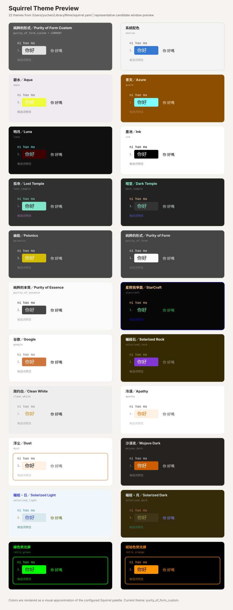

# 鼠须管 Squirrel 内置主题配色预览

鼠须管（Squirrel）是 macOS 上的 Rime 输入法，自带 20 多套内置配色主题，涵盖亮色、暗色、复古等不同风格。本文以候选窗预览图的形式展示全部内置主题，方便直观对比和选择。



## 主题一览

预览图按顺序展示了以下 22 套主题：

| 主题名 | 配置键 | 风格 |
| --- | --- | --- |
| 純粹的形式（自定义） | `purity_of_form_custom` | 当前使用，灰色系 |
| 系統配色 | `native` | 跟随 macOS 系统 |
| 碧水 | `aqua` | 亮色 |
| 青天 | `azure` | 深棕底 |
| 明月 | `luna` | 深色 |
| 墨池 | `ink` | 黑白极简 |
| 孤寺 | `lost_temple` | 深色绿字 |
| 暗堂 | `dark_temple` | 深色 |
| 幽能 | `psionics` | 深色 |
| 純粹的形式 | `purity_of_form` | 深色 |
| 純粹的本質 | `purity_of_essence` | 亮色 |
| 星際我爭霸 | `starcraft` | 游戏风 |
| 谷歌 | `google` | 亮色 |
| 曬經石 | `solarized_rock` | 深色 |
| 简约白 | `clean_white` | 亮色 |
| 冷漠 | `apathy` | 亮色 |
| 浮尘 | `dust` | 亮色 |
| 沙漠夜 | `mojave_dark` | 深色 |
| 曬經・日 | `solarized_light` | Solarized 亮色 |
| 曬經・月 | `solarized_dark` | Solarized 深色 |
| 綠色熒光屏 | `retro_green` | 复古绿 |
| 琥珀色熒光屏 | `retro_orange` | 复古橙 |

## 如何切换主题

在 `~/Library/Rime/squirrel.yaml` 中修改 `style/color_scheme` 字段，例如：

```yaml
style:
  color_scheme: luna
```

保存后重新部署（`Ctrl+Option+`~`` 或点击菜单栏输入法图标选择「重新部署」）即可生效。

## 自定义主题

如果内置主题都不满意，可以在 `squirrel.yaml` 中定义自己的配色方案，参考默认的 `purity_of_form` 结构，调整 `back_color`、`candidate_text_color`、`highlighted_candidate_back_color` 等字段即可。
