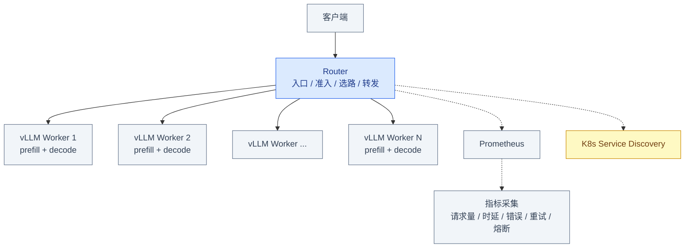
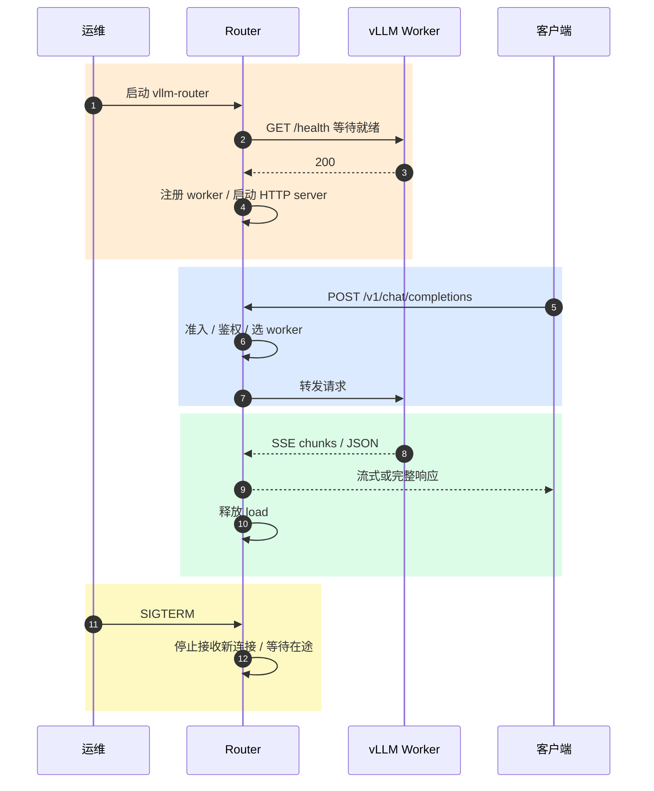
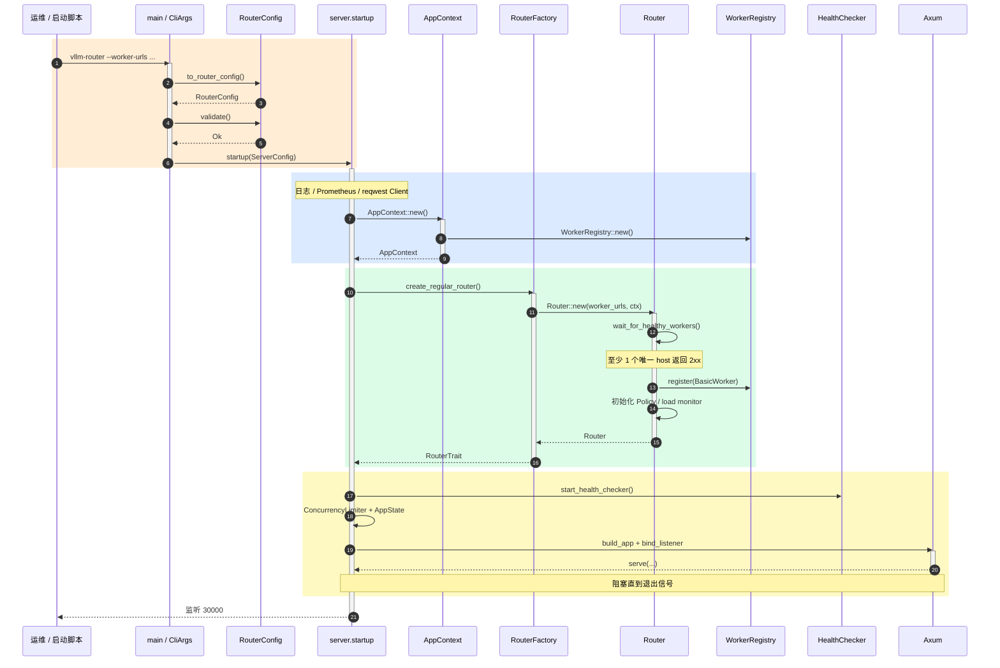
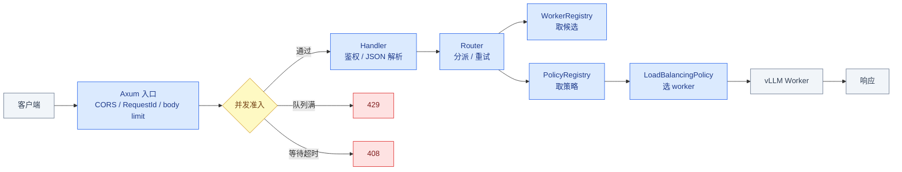
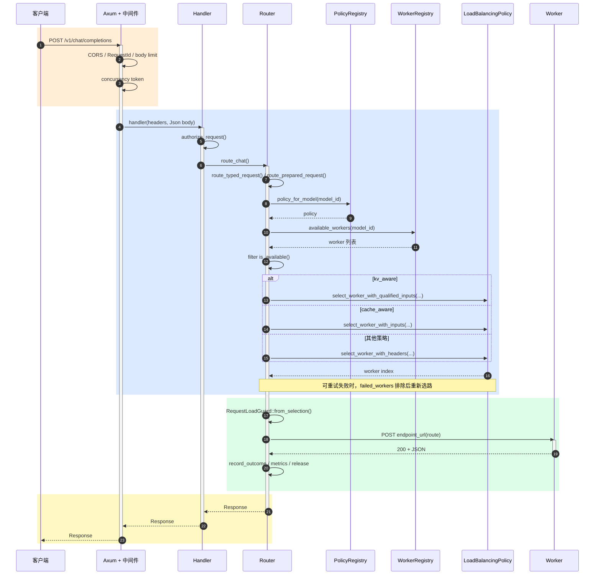
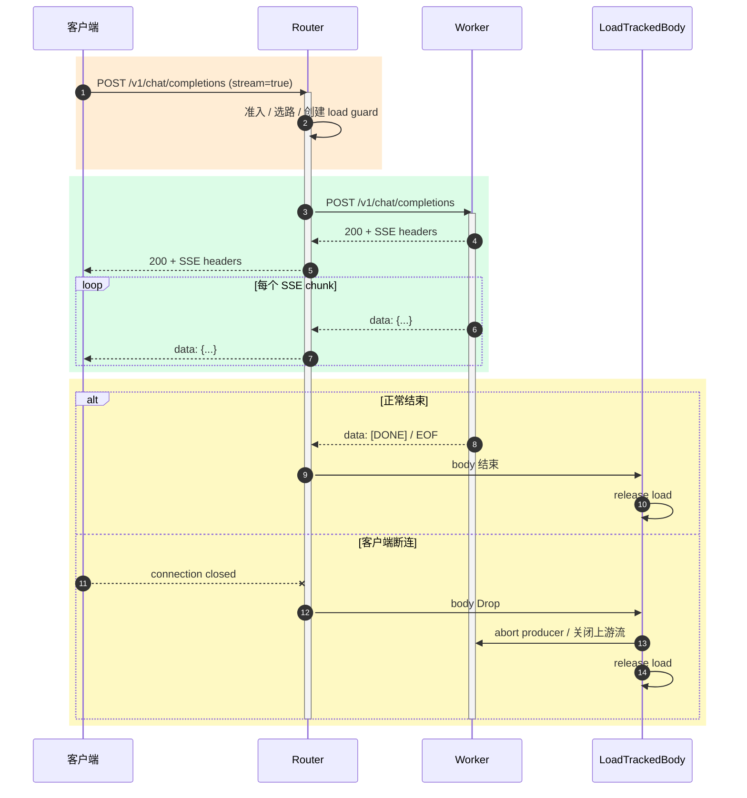
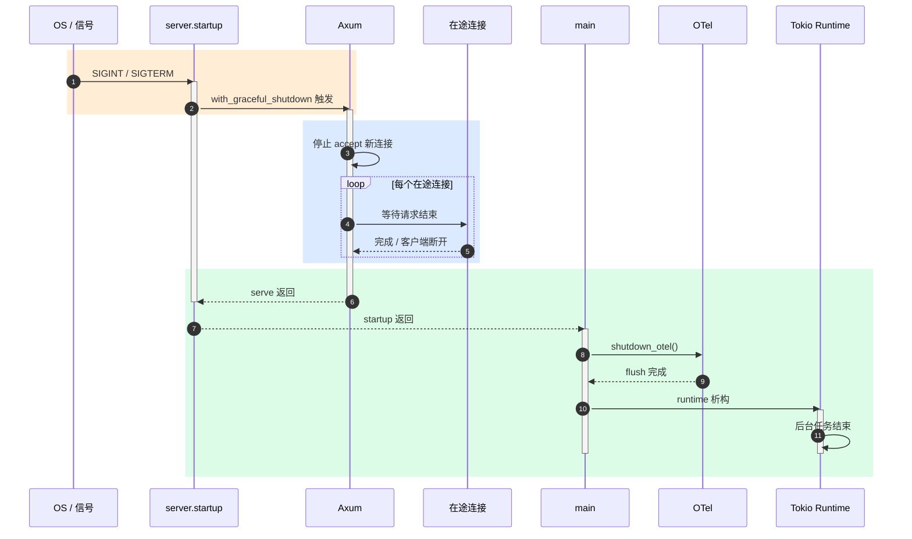
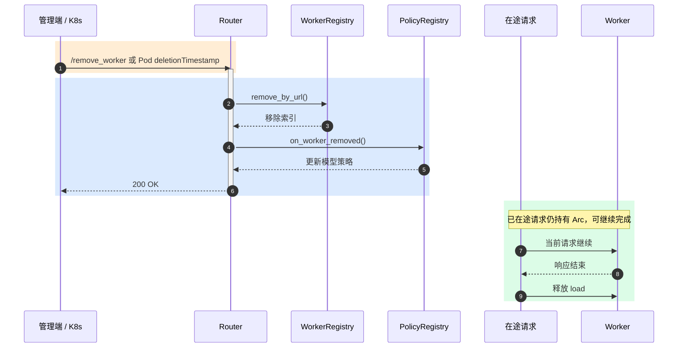
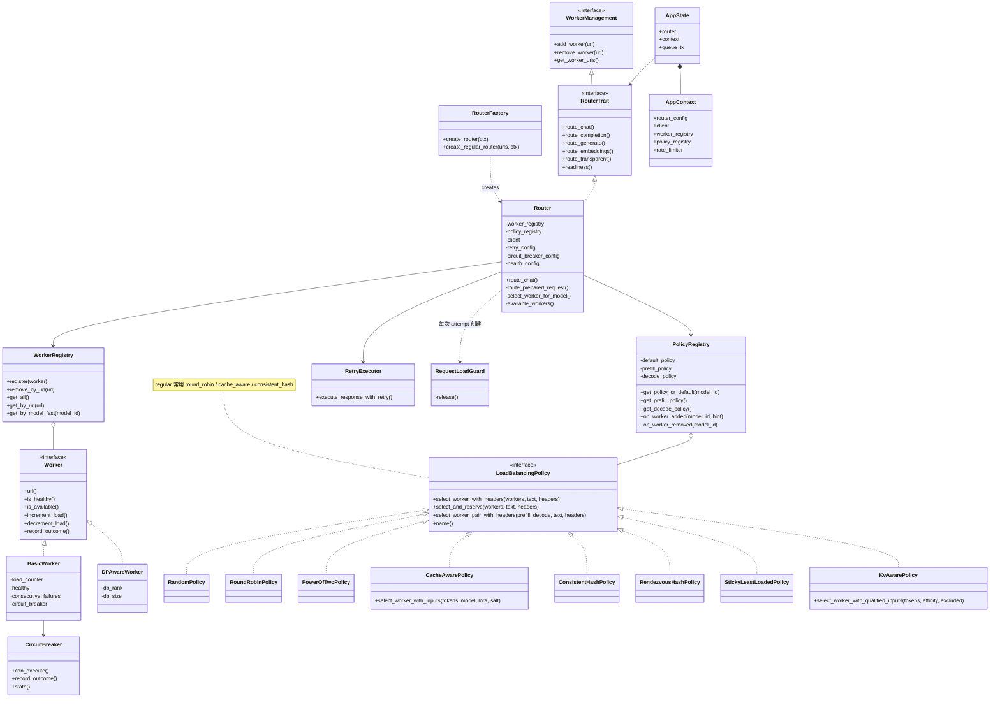

# vLLM Router 在 regular 混部下的生命周期

> 源码基线：`router/`，vLLM Router `v0.1.17`。
>
> 场景：regular 非 PD 分离，prefill 和 decode 在同一个 vLLM 实例内，Router 只有一个 worker pool。
>
> 本文先按时间顺序走一遍完整流程，再回到源码，看每个阶段由哪些组件完成。只讨论 `router/` 里的上游实现，不展开适配层。

## 请求生命周期的四个阶段

regular 混部的部署形态很简单：客户端只认识 Router，Router 只认识一个 worker pool。每个 worker 同时承担 prefill 和 decode，一条请求只选一个 worker，一次 HTTP 转发完成。



一条请求的完整生命周期可以分成四段：

| 阶段 | 触发 | 关键动作 | 结果 |
|---|---|---|---|
| 启动 | 运维执行 `vllm-router` | 读配置、建依赖、等 worker、开端口 | Router 进入监听状态 |
| 接收 | 客户端发请求 | 准入、鉴权、分派、选 worker、转发 | worker 开始生成 |
| 响应 | worker 返回 | SSE 透传或 JSON 聚合、释放 load、记录指标 | 客户端拿到结果 |
| 退出 | SIGTERM 或 worker 下线 | 停止接入、等待在途、摘除 worker | 进程结束或新请求绕开 |

把这四段串起来，就是下面这张宏观时序图：



橙色是启动，蓝色是接收，绿色是响应，黄色是退出。下面按这四段展开：每一段先讲“流程上发生了什么”，再回到源码看“具体由谁完成、关键判断是什么”。

## Router 启动流程

### 启动阶段的主要动作

启动阶段只做四件事：

1. **解析命令行参数，生成 RouterConfig**：确定 regular 模式、worker 列表、监听地址、策略、超时和可靠性参数。
2. **初始化日志、指标和 HTTP 客户端**：准备 Prometheus、`reqwest::Client` 等运行时依赖。
3. **等待 worker 就绪并注册实例**：至少一个 worker 健康后，把配置里的 worker 写入 `WorkerRegistry`。
4. **组装 Axum 应用并绑定端口**：注册路由和中间件，调用 `bind_listener`，进入 `serve`。

这四步的顺序不能随意调换。比如 Router 必须先有 `WorkerRegistry` 才能注册 worker，必须先等 worker 健康才能让请求选到 worker，必须先组装好 `AppState` 才能构建 Axum 应用。

### 配置入口

Rust 二进制的入口在 `src/main.rs`：

1. `dotenvy::dotenv()` 读取环境变量。
2. `split_prefill_args_from_others` 先摘出 `--prefill URL [PORT]`，因为 clap 不适合处理可选端口。
3. clap 解析 `CliArgs`，得到 host、port、worker URL、策略、超时、重试、熔断等参数。
4. `CliArgs::to_router_config` 把 CLI 参数转成 `RouterConfig`。regular 模式下如果既没有 `--worker-urls` 也没有启用服务发现，这里会直接报错。
5. `router_config.validate()` 校验 URL、混合协议、策略、重试、熔断、健康检查和 metrics 配置。
6. `CliArgs::to_server_config` 组装 `ServerConfig`，再调用 `server::startup`。

Python 启动器的路径是：

```text
vllm-router console script
  → launch_router
  → Router.from_args
  → PyO3 Router.start()
  → server::startup
```

两条路径最终汇合到同一个 `startup`，所以后面的装配流程对两者都成立。

### startup 装配顺序

`server::startup` 的顺序有依赖关系：

1. **初始化日志和 Prometheus**。日志 guard 保存在 `startup` 栈上；Prometheus exporter 按配置启动，Rust CLI 默认 `127.0.0.1:29000`。
2. **创建 HTTP client**。连接池上限 500，请求超时取 `request_timeout_secs`，连接超时 10 秒，开启 `tcp_nodelay` 和 30 秒 keepalive。这个 client 后续既用于 worker 请求，也用于健康检查和 KV 发现。
3. **创建 `AppContext`**。这里创建 `WorkerRegistry`、`PolicyRegistry`、`TokenBucket`、响应存储和 API key 缓存。`PolicyRegistry` 在构造时就把默认策略实例创建好。
4. **创建 Router**。`RouterFactory::create_router` 根据 `RoutingMode` 分支；regular 模式进入 `create_regular_router`，最终调用 `Router::new(worker_urls, ctx)`。
5. **等待 worker 并注册**。`Router::new` 先等待至少一个唯一 host 健康，再按 DP 配置展开 worker，创建 `BasicWorker` 或 `DPAwareWorker`，注册到 `WorkerRegistry`，并通知 `PolicyRegistry`。
6. **启动后台任务**。包括健康检查、并发队列处理器、可选的 K8s 服务发现、`power_of_two` 的 load monitor、KV-aware 的 supervisor 等。
7. **组装 Axum 应用**。注册推理、健康、管理、worker 管理四组路由，叠加中间件和 body limit，设置 fallback。
8. **绑定监听并 serve**。`bind_listener` 设置 `TCP_NODELAY`，然后 `serve(...).with_graceful_shutdown(shutdown_signal())`。

### worker 注册阶段的健康检查

`Router::new` 里的 `wait_for_healthy_workers` 是启动阶段最关键的逻辑。

它先把 worker URL 按 `@dp_rank` 去掉后缀，得到唯一 host 集合，然后并发请求每个 host 的 `/health`。只要有一个 host 返回 2xx，就认为启动条件满足，继续注册所有 worker；如果一个都没有，就每隔 `worker_startup_check_interval_secs` 重试，直到 `worker_startup_timeout_secs` 超时。

这个设计有三个直接后果：

- Router 可以在“部分 worker 未就绪”时启动。
- 启动成功不代表所有 worker 都可用，后台健康检查会继续修正状态。
- `/health` 不能当作全量 worker 就绪信号，真正要判断全量状态应看 `/readiness` 和 `/list_workers`，或者直接查 worker 自身。

`BasicWorker::new` 把 `healthy` 初始化为 `true`。注册完成后，`start_health_checker` 按 `health_check.check_interval_secs` 周期检查 `/health`：

- 连续失败达到 `failure_threshold`，标记不健康。
- 连续成功达到 `success_threshold`，恢复健康。
- 标记变化会更新指标，并触发 registry 的拓扑修订。

还有一个容易忽略的差异：`/readiness` 只统计 `is_healthy()`，而选路用的是 `is_available()`。熔断打开的 worker 可能让 `/readiness` 仍然返回 ready，但请求不会选它。排查 503 时要同时看健康状态和熔断状态。

### 启动时序图



### 默认值与启动示例

| 参数 | 默认值 | 说明 |
|---|---|---|
| `--host` | `127.0.0.1` | 监听地址 |
| `--port` | `30000` | 监听端口 |
| `--policy` | `cache_aware` | CLI 默认策略 |
| `--worker-startup-timeout-secs` | `600` | 等待 worker 的超时 |
| `--worker-startup-check-interval-secs` | `30` | 等待检查间隔 |
| `--request-timeout-secs` | `1800` | 上游请求超时 |
| `--max-payload-size` | `512 MiB` | 请求体上限 |
| `--max-concurrent-requests` | `32768` | 并发 token 数 |
| 队列 | `100` / `60s` | Rust CLI 固定值，未暴露为参数 |
| 重试 | `5` 次 attempt / `50ms` / `30s` / `1.5` / `0.2` | 次数 / 初始 / 上限 / 倍率 / 抖动 |
| 熔断 | `10` / `3` / `60s` / `120s` | 失败阈值 / 成功阈值 / 打开时长 / 窗口 |
| 健康检查 | `3` / `2` / `5s` / `60s` / `/health` | 失败 / 成功 / 超时 / 间隔 / 路径 |
| Prometheus | `127.0.0.1:29000` | 指标端口 |

这里有两个容易踩的默认值问题：

- `CliArgs` 的 `--policy` 默认是 `cache_aware`，但 `RouterConfig::default()` 用的是 `PolicyConfig::Random`。直接构造配置对象和走 CLI 会得到不同的策略。
- Rust CLI 没有暴露 queue size 和 queue timeout，固定为 100 和 60 秒；Python 启动器有对应参数。两者行为不完全一致。

一个最小启动命令：

```bash
./target/release/vllm-router \
  --host 0.0.0.0 \
  --port 30000 \
  --worker-urls http://10.0.0.11:8000 http://10.0.0.12:8000 \
  --policy cache_aware \
  --worker-startup-timeout-secs 600 \
  --worker-startup-check-interval-secs 30 \
  --request-timeout-secs 1800 \
  --max-concurrent-requests 4096 \
  --prometheus-host 0.0.0.0 \
  --prometheus-port 29000
```

## 请求接入与 worker 选择

### 请求处理的五个关口

请求阶段可以想成五个关口。每个关口都可能把请求拦下来，也可能把请求交给下一层：



五个关口依次做这些事：

1. **处理入口请求**：完成 CORS、请求 ID 和 body limit。
2. **执行并发准入**：从 `TokenBucket` 取 token，取不到就排队或拒绝。
3. **鉴权并分派请求**：校验 Bearer token，反序列化 JSON，进入 `RouterTrait`。
4. **筛选并选择 worker**：过滤可用 worker，按策略选一个。
5. **构造请求并转发**：拼目标 URL，发送 HTTP 请求，处理响应。

下面按这五个关口展开。

### 入口与准入

`build_app_with_wasm_middleware` 把路由分成四组：

- 推理路由：`/v1/chat/completions`、`/v1/completions`、`/v1/embeddings`、`/v1/responses`、`/generate` 等。
- 公共路由：`/health`、`/readiness`、`/liveness`、`/v1/models`。
- 管理路由：`/add_worker`、`/remove_worker`、`/list_workers`、`/get_loads`。
- worker 管理路由：`/workers` 系列。

推理路由外面套了并发限制和可选的 WASM middleware；全局层还有 CORS、请求 ID、body limit。请求路径大致是：

```text
CORS → RequestId → body limit → concurrency limit → WASM → handler
```

并发限制的实现在 `middleware::concurrency_limit_middleware`：

- 先尝试从 `TokenBucket` 拿一个 token。
- 拿到就执行 handler，结束后归还 token。
- 拿不到就尝试入队；队列满返回 429（带 `Retry-After`），等待超时返回 408。
- 队列处理器在独立 task 中等待 token，拿到后通过 oneshot 通知请求继续。

regular 路径没有独立的“请求拉取线程”。请求由 Axum handler 直接驱动，队列只负责在 token 不足时排队，不负责主动拉取请求。

### 鉴权与分派

handler 收到请求后：

1. `authorize_request` 检查 Bearer token。配置了 `api_key_validation_urls` 时，会调用外部校验服务；未配置时直接放行。`api_key` 是访问 worker 的凭据，不用于客户端入站校验。
2. Axum 的 `Json<ChatCompletionRequest>` 已经把 body 反序列化成 typed request。
3. `state.router.route_chat(headers, &body, None)` 进入 `RouterTrait`。
4. `Router::route_chat` 调用 `route_typed_request`，再进入 `route_prepared_request`。

`route_prepared_request` 是请求处理的核心函数，按顺序做这些事：

1. 记录开始时间，读取 `is_stream`。
2. 解析 `model`，只在 registry 中存在该模型时才作为路由条件。
3. 判断 worker pool 是 HTTP 还是 gRPC。混合协议在初始化和 `add_worker` 时就会被拒绝。
4. gRPC pool 会先做 tokenize；HTTP pool 保留原始 body 或 typed request。
5. 创建 `RetryExecutor` 所需的 attempt 循环。
6. 每次 attempt 重新取可用 worker、重新选路、创建 `RequestLoadGuard`、发送请求、记录结果。
7. 根据响应状态决定是否重试。

### worker 选择

选路入口是 `select_worker_for_model`。策略由 `PolicyRegistry` 按 `model_id` 提供；非 IGW 的单模型场景通常就是 `--policy` 创建的默认实例。`kv_aware` 和 `cache_aware` 在选路前会准备 token 输入，其他策略只按需使用文本或 headers。

1. `policy_for_model(model_id)` 取该模型的策略，没有就用默认策略。
2. `available_workers(model_id)` 从 registry 取候选，再过滤 `worker.is_available()`。
3. 根据策略类型选择：
   - `kv_aware` 走 `select_worker_with_qualified_inputs`，输入包含 token、session affinity 和 excluded workers。
   - `cache_aware` 走 `select_worker_with_inputs`，输入包含 token、模型、LoRA、cache salt。
   - 其他策略走 `select_worker_with_headers`，例如 `round_robin`、`random`、`consistent_hash`。
4. 返回选中的 worker 和可选的 KV receipt。
5. 创建 `RequestLoadGuard`，对需要跟踪负载的策略先增加 worker load，再发起请求；响应结束或失败后释放。

重试时，失败的 worker 会进入 `failed_workers` 列表，下一次选路作为 `excluded_workers` 传入。`kv_aware` 不会因为重试清除已有的 affinity 绑定，避免把同一会话强行切到另一个 worker。

`model` 过滤是“尽力而为”，不是强约束：

- `route_prepared_request` 只有在 `worker_registry.has_model(model)` 为真时才按模型过滤。
- 普通 HTTP worker 的 `model_id` 来自 `WorkerMetadata.labels`，没有设置时是 `unknown`。
- 单模型场景下这通常不影响结果；多模型场景需要给 worker 补模型元数据，否则可能出现请求 model A 却落到 model B 的风险。

### 请求转发

`send_typed_request` 负责真正发请求：

1. 通过 `worker.endpoint_url(route)` 拼出目标 URL，例如 `http://10.0.0.11:8000/v1/chat/completions`。
2. 如果是 DP-aware 模式，从 `host:port@rank` 中取出 rank，并加 `X-data-parallel-rank` header。
3. 复制客户端 header，过滤 hop-by-hop header、`Content-Type`、`Content-Length` 和 trace header，避免把连接级字段带给 worker。
4. 如果有配置 `api_key`，注入 `Authorization: Bearer ...`。
5. 用 `reqwest::Client` 发送请求。

非流式路径：

- 等待 `res.bytes()` 拿到完整 body。
- 保留上游响应头和状态码。
- 返回 `Response`，`RequestLoadGuard` 在函数结束时释放 load。

流式路径：

- 用 `res.bytes_stream()` 逐块读取上游 SSE。
- 创建一个无界 channel，把上游 chunk 送进 channel，再包成 `Body::from_stream`。
- 首个 chunk 到达时记录首 token 时间。
- `LoadTrackedBody` 在 body 结束或 Drop 时释放 load。
- 客户端断连时，body 被丢弃，`LoadTrackedBody::drop` abort 上游 producer，避免后台继续读流。

### 非流式请求时序图



图中只画成功路径。可重试失败会在同一个 attempt 循环里把失败 worker 放入 `failed_workers`，下一轮选路时排除。

## 响应透传与请求收尾

### 响应阶段的主要工作

请求转发到 worker 后，响应阶段的核心问题是：**上游的生成过程如何映射到客户端连接上？**

- 非流式：等上游完整 JSON，再一次性返回。
- 流式：上游每产生一段 SSE，就尽快写给客户端，同时记录首 token 时间。
- 无论哪种，请求结束后都要释放 worker load、记录指标，并处理重试和熔断。

流式请求的关键不是“把 chunk 转发出去”，而是把上游响应的生命周期和客户端连接绑定起来。

### SSE 透传

`send_typed_request` 拿到上游 `bytes_stream` 后，会创建一个无界 channel，把读取任务放进 `tokio::spawn`：

- 上游每来一个 chunk，就通过 channel 发给 Axum 的 body。
- 首 chunk 到达时记录首 token 时间，用于 TTFT 指标。
- 如果 chunk 里出现 `data: [DONE]`，会提前释放 load。
- 上游 EOF 或错误时，producer 结束，body 关闭。

响应 body 被包成 `LoadTrackedBody`，它在三种情况下释放 load：

- body 正常读完。
- body 被丢弃，例如客户端断连。
- producer task 结束。

客户端断连时，`LoadTrackedBody::drop` 会 abort producer，避免 Router 继续从 worker 读流。这一点对长流式请求很重要：如果没有这个 Drop，客户端走了以后 worker 可能还在生成，load 也不会释放。

### 流式请求时序图



### 重试与熔断

`RetryExecutor::execute_response_with_retry` 是统一的 attempt 循环：

- `max_retries` 表示最多 attempt 次数，包含首次请求。
- 每次 attempt 的闭包重新选 worker、重新创建 load guard、重新发送请求；失败 worker 记入 `failed_workers`，下一次选路排除。
- `should_retry` 只看状态码，`is_retryable_status` 覆盖 408、429、500、502、503、504。
- 退避使用指数增长、上限截断和抖动；默认初始 50 ms、上限 30 s、倍率 1.5、抖动 0.2。
- 4xx 不重试，也不计入熔断失败；5xx 和连接错误会记为失败。
- `kv_aware` 重试时保留已有 session affinity，不会因排除失败 worker 而清除绑定。

熔断器在 `BasicWorker` 内，状态机是：

```text
Closed --失败达到阈值--> Open
Open --等待 timeout--> HalfOpen
HalfOpen --成功达到阈值--> Closed
HalfOpen --失败一次--> Open
```

`is_available()` 会把 Open 状态的 worker 排除在选路之外。`/readiness` 只统计 `is_healthy()`，所以熔断打开的 worker 可能让 readiness 仍然返回 ready，但请求不会选它。排查 503 时要同时看健康状态和熔断状态。

### 请求退出

一次请求有六种常见结束方式：

| 路径 | 触发条件 | 结果 |
|---|---|---|
| 非流式正常结束 | 上游返回完整 body | 返回 JSON，释放 load，记录请求指标 |
| 流式正常结束 | 收到 `[DONE]` 或 EOF | 返回 200 响应头时记录请求指标；body 结束释放 load |
| 客户端断连 | 客户端关闭连接 | body Drop，abort producer，释放 load |
| 上游 5xx | worker 返回可重试状态 | 按策略重试；重试耗尽后返回最后一次响应 |
| 无可用 worker | 全部不健康或熔断打开 | 返回 503，记录 `no_available_workers` |
| 进程退出 | SIGINT / SIGTERM | 不再接收新连接，等待在途连接结束 |

关键代码是 `RequestLoadGuard` 和 `LoadTrackedBody`：

- `RequestLoadGuard` 内部用 `AtomicBool` 保证只释放一次。
- `LoadTrackedBody` 在正常 EOF 时释放 load。
- `LoadTrackedBody::drop` 在客户端断连时 abort 上游 producer，再释放 load。
- `worker.decrement_load()` 使用 `checked_sub`，避免重复释放把计数减成负数。

## 退出流程与 worker 摘除

### 退出流程的三条路径

退出有三条线，不要混在一起：

- **请求退出**：一条请求正常结束、失败、被重试或客户端断连。
- **进程退出**：Router 收到 SIGINT/SIGTERM，停止接收新连接，等待在途请求。
- **worker 下线**：管理接口、K8s 发现或健康检查把某个 worker 从池子里摘掉。

三条线的时间尺度不同：请求退出是毫秒到分钟级，进程退出取决于在途请求，worker 下线则是一个持续的健康和拓扑过程。

### 进程退出

`server::startup` 最后调用：

```rust
serve(listener, app)
    .with_graceful_shutdown(shutdown_signal())
    .await
```

`shutdown_signal` 同时监听 Ctrl+C 和 SIGTERM。Axum 停止接受新连接，等待已有连接结束；代码里没有额外的 drain 超时。长流式请求会延长退出时间，最终依赖编排层的 `terminationGracePeriodSeconds` 或 SIGKILL 兜底。

进程退出时：

- 不再接收新请求。
- 在途请求继续执行，直到连接结束或被客户端断开。
- `startup` 返回后，`main` 调用 OTel shutdown，刷出最后一批 span。
- Tokio runtime 析构，后台健康检查、load monitor、service discovery 等任务结束。

Python 启动路径同样进入 `server::startup`，但 Python 主线程对 SIGINT 的处理与二进制不同；Ctrl+C 的实际行为需要按入口单独验证，不能直接套用二进制结论。



### worker 摘除

worker 下线有三条路径：

| 路径 | 代码 | 行为 |
|---|---|---|
| 管理接口 | `/remove_worker` → `Router::remove_worker` | 从 registry 和 policy 移除；新请求不再选它 |
| K8s 发现 | `service_discovery.rs` | Pod 带 `deletionTimestamp` 时触发 `remove_worker` |
| 健康检查 | `start_health_checker` | 连续失败后标记 unhealthy；选路时被过滤 |

已经在途的请求持有 `Arc<dyn Worker>`，摘除不会强行取消它；请求继续使用原来的 worker 连接，结束后释放 load。新请求看到的是更新后的 registry。



### drain 接口缺失的影响

Router 收到 SIGTERM 后不会主动告诉客户端“不要再发请求”，也不会在固定时间后强制关闭在途连接。它只做两件事：

- 停止 accept 新连接。
- 等已有连接自己结束。

这带来一个运维上的边界：滚动升级时，如果客户端持续保持长连接或长流式请求，Router 的退出时间会被拉长。生产上通常用 K8s 的 readiness、preStop 和 `terminationGracePeriodSeconds` 配合解决，而不是依赖 Router 内部计时。

## 核心组件与流程分工

前面按时间顺序看了流程。现在回头把组件补齐，会更容易理解它们为什么存在。

### 类图

图中只展开 regular 的 `Router`，省略 EPD 和 Program Scheduling 字段；`RouterFactory` 的其他分支用表格补充。`RouterTrait` 继承 `WorkerManagement`，所以路由对象本身也承担 `add_worker` / `remove_worker`。



`RouterFactory` 还能创建 `VllmPDRouter` 和 `OpenAIRouter`；IGW 模式下由 `RouterManager` 先按 model 选 Router。本文只展开 regular 的 `Router`，其他实现只用来定位它：

| 实现 | 选择单元 | 失败处理 |
|---|---|---|
| `Router`（regular） | 单个 worker | 重试时排除失败 worker |
| `VllmPDRouter` | P、D 各一个 | P 失败不进入 D；D 失败释放 attempt |
| `OpenAIRouter` | 固定上游 | 熔断器拦截 |
| `RouterManager`（IGW） | 先选 Router，再选 worker | 无匹配 model 返回 404 |

### 组件分工

| 组件 | 源码位置 | 在流程中的位置 |
|---|---|---|
| `main` / `CliArgs` | `src/main.rs` | 启动阶段，把命令行变成配置 |
| `RouterConfig` / `ConfigValidator` | `src/config/` | 启动阶段，校验模式和参数 |
| `server::startup` | `src/server.rs` | 启动阶段，装配依赖并启动 HTTP server |
| `AppContext` | `src/server.rs` | 进程级共享依赖：registry、policy、client、限流器 |
| `AppState` | `src/server.rs` | 请求阶段，Axum handler 的入口状态 |
| `WorkerManagement` / `RouterTrait` | `src/routers/mod.rs` | 定义路由对象和 worker 管理接口 |
| `RouterFactory` | `src/routers/factory.rs` | 启动阶段，按模式创建 regular / PD / OpenAI Router |
| `Router`（regular） | `src/routers/http/router.rs` | 请求阶段，选 worker、转发、重试 |
| `WorkerRegistry` | `src/core/worker_registry.rs` | 启动、请求和退出阶段，维护 worker 索引 |
| `PolicyRegistry` | `src/policies/registry.rs` | 请求阶段，提供默认策略和按模型策略 |
| `LoadBalancingPolicy` | `src/policies/` | 请求阶段，按策略选择 worker |
| `Worker` / `BasicWorker` / `DPAwareWorker` | `src/core/worker.rs` | 请求和退出阶段，维护健康、load、熔断、DP rank |
| 中间件 / `TokenBucket` | `src/middleware.rs` | 请求阶段，准入和排队 |
| `RetryExecutor` | `src/core/retry.rs` | 请求阶段，attempt 循环和退避 |
| `CircuitBreaker` | `src/core/circuit_breaker.rs` | 请求阶段，隔离失败 worker |
| `RequestLoadGuard` / `LoadTrackedBody` | `src/routers/http/router.rs` | 响应阶段，释放 load、处理断连 |
| `RouterMetrics` | `src/metrics.rs` | 全流程，记录请求、重试、熔断、load |
| `ServiceDiscovery` | `src/service_discovery.rs` | 退出阶段，处理 Pod 下线 |

### 关键组件说明

**`WorkerRegistry` 不是简单的 Vec。** 它同时维护 URL 到 worker ID 的映射、按模型索引、按 worker 类型索引、按连接方式索引，以及注册顺序。这样选路时可以直接按模型取候选，不需要每次遍历全部 worker。注册和移除都会更新索引，并调用 `notify_worker_state_change()`，让依赖方感知拓扑变化。

**`PolicyRegistry` 管的是策略实例，不是选路结果。** 默认策略在 `AppContext::new` 时创建；worker 增加时，`on_worker_added` 按模型维护策略和 worker 计数。`Router` 每次请求只向它要一个策略对象，再调用策略的 `select_worker`。`PolicyRegistry` 还保留了 prefill / decode 策略槽位，regular 路径只使用 `default_policy`。

**`LoadBalancingPolicy` 把选路差异收敛到一个接口。** regular 路径下，`cache_aware` 使用 token 输入，`kv_aware` 使用带 affinity / excluded 的 qualified inputs，其余策略主要看文本和 headers。8 种实现共享同一套返回 worker index 的契约，`PolicyRegistry` 负责按模型提供默认实例或模型实例。

**`BasicWorker` 是健康与负载的唯一事实来源。** `is_available()` 同时看健康标记和熔断器：

```text
is_available = is_healthy && circuit_breaker.can_execute()
```

`record_outcome` 在 2xx 和 4xx 时记为成功，5xx 或连接错误才记为失败。这个细节决定了重试和熔断的行为。

`DPAwareWorker` 是 `BasicWorker` 的变体，额外保存 `dp_rank` 和 `dp_size`。DP-aware 模式下，每个 rank 都是独立的选路单元，请求会带 `X-data-parallel-rank`。

## gRPC worker 与 Python 启动器

**gRPC worker**：上游支持 `grpc://` worker。`route_prepared_request` 会先用 `EngineFrontend` 把 chat 请求编码成 token，再走 gRPC dispatch；当前只支持 `/v1/chat/completions` 和 `/v1/completions`，且不能和 HTTP worker 混在同一个 pool。regular HTTP 混部不需要走到这条路径。

**Python 启动器**：`vllm-router` console script 最终也调用 `Router.start()` 和 `server::startup`，差别主要在参数转换和进程信号处理。阅读源码时可以把两条路径都映射到同一个 `startup`，不需要分别理解两套生命周期。`--mini-lb` 是独立的 Python 调试实现，只支持 random，不实现 `RouterTrait`，不属于 regular 路径。

## 设计取舍与边界

Router 的实现有几处明显的取舍，理解它们比记住参数更有用。

**第一，它是无状态转发，不是请求队列。**

请求状态只存在于当前连接、`RequestLoadGuard` 和响应体里。进程退出不会恢复在途请求，也没有跨实例的请求队列。这让 Router 可以水平扩展，但也意味着它不适合做需要持久化排队的任务。

**第二，健康检查和选路用的不是同一个判断。**

`/readiness` 看 `is_healthy()`，选路看 `is_available()`。熔断打开的 worker 仍然可能是“健康”的，但不会被选中。这个差异会直接影响排障：readiness 表达进程是否还能服务，选路表达当前是否应该把请求发给某个 worker。

**第三，重试是 at-least-once，不是 exactly-once。**

每次 attempt 都可能已经让 worker 开始生成，只是响应失败或超时。重试会重新选 worker、重新发请求，可能产生额外的 token 消耗。对推理请求来说这通常可以接受，但要在网关层设置总超时，避免客户端已经断开而 Router 还在重试。

**第四，负载生命周期绑定在响应体上。**

`RequestLoadGuard` 不是请求结束时手动释放，而是跟着 body 走。正常 EOF、客户端断连、producer abort 都会触发释放。流式路径依赖 `LoadTrackedBody`，非流式路径依赖 `RequestLoadGuard` 在函数结束时释放；两条路径都要求 load 的创建和释放成对出现。

**第五，模型过滤是尽力而为。**

普通 HTTP worker 没有模型标签时，`model_id` 是 `unknown`，`model` 字段不会成为强约束。单模型部署没有问题；多模型部署需要额外维护 worker 的模型元数据，否则不能假设请求一定落到同名模型。

**第六，K8s 发现是可选路径。**

源码里有 regular 模式的 Pod 发现逻辑，但它依赖集群权限、selector 和 Pod 生命周期。静态 worker 列表更适合先做小规模验证，因为拓扑变化更可控。

## 小结

regular 混部下，vLLM Router 的生命周期可以概括成三句话：

- 启动时把配置、client、registry、policy、健康检查和 HTTP server 装配起来，等到至少一个 worker 健康就开始服务。
- 请求进入后先准入，再选一个可用 worker，通过 HTTP 转发；流式响应按 SSE 透传，load 跟着响应体释放。
- 退出时停止接收新连接，等待在途请求结束；worker 摘除只影响新请求，不会强行取消已经在途的请求。

把这套路径读清楚，再看 PD、KV-aware、Program Scheduling 这些扩展，会更容易判断它们分别插在生命周期的哪一段。

## 源码索引

| 主题 | 文件 | 关键符号 |
|---|---|---|
| 进程入口 | `src/main.rs` | `main`、`CliArgs`、`to_router_config` |
| 配置校验 | `src/config/validation.rs` | `ConfigValidator::validate` |
| 服务启动 | `src/server.rs` | `startup`、`build_app_with_wasm_middleware`、`bind_listener` |
| regular Router | `src/routers/http/router.rs` | `Router::new`、`route_prepared_request`、`send_typed_request` |
| 请求路由接口 | `src/routers/mod.rs` | `WorkerManagement`、`RouterTrait` |
| worker 注册表 | `src/core/worker_registry.rs` | `WorkerRegistry::register`、`remove_by_url` |
| worker 状态 | `src/core/worker.rs` | `BasicWorker`、`is_available`、`record_outcome` |
| 策略注册表 | `src/policies/registry.rs` | `PolicyRegistry`、`on_worker_added` |
| 重试 | `src/core/retry.rs` | `RetryExecutor`、`is_retryable_status` |
| 熔断 | `src/core/circuit_breaker.rs` | `CircuitBreaker`、`CircuitState` |
| 并发准入 | `src/middleware.rs` | `concurrency_limit_middleware`、`QueueProcessor` |
| 流式 body | `src/routers/http/router.rs` | `LoadTrackedBody`、`hold_request_load_with_output_frame` |
| 服务发现 | `src/service_discovery.rs` | `start_service_discovery`、`handle_pod_deletion` |
| 指标 | `src/metrics.rs` | `RouterMetrics`、`start_prometheus` |
| 其他 Router 实现 | `src/routers/http/vllm_pd_router.rs`、`src/routers/http/openai_router.rs`、`src/routers/router_manager.rs` | 对照用，不在本文展开 |
